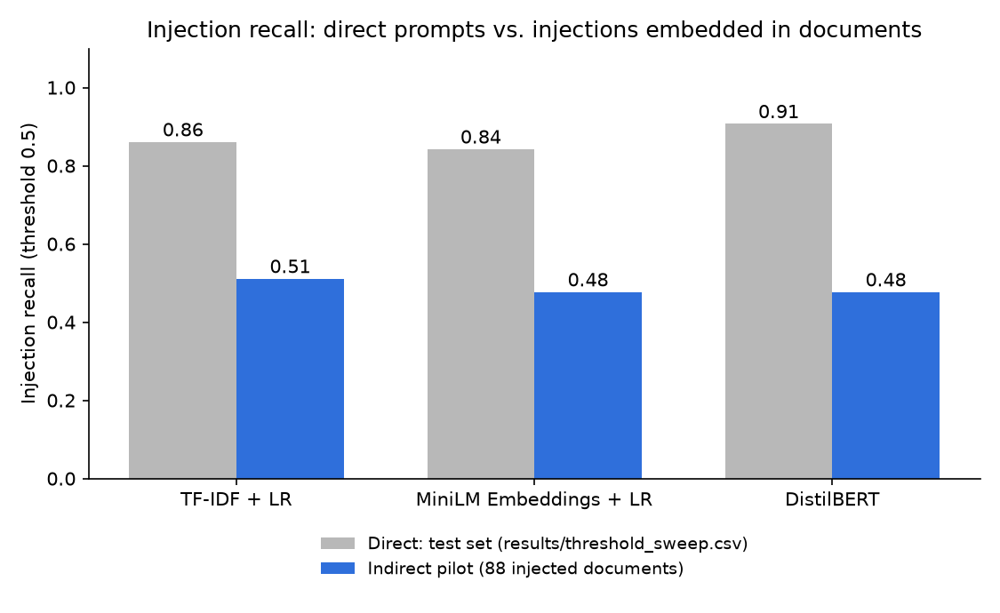

# Indirect Prompt Injection Pilot

The three trained classifiers, with no retraining, scored on `data/indirect_pilot/indirect_pilot.csv`: 276 documents built by `scripts/build_indirect_pilot.py`, in which 88 injection prompts and 138 benign prompts from the test split and hand-crafted holdout are embedded at the start, middle or end of a short SQuAD Wikipedia paragraph, plus 50 unmodified paragraphs. All numbers use the default 0.5 decision threshold.

## Overall

| Model | Precision | Recall | F1 | FPR | Direct test recall | Same payloads, standalone |
|---|---|---|---|---|---|---|
| TF-IDF + LR | 0.938 | 0.511 | 0.662 | 0.016 | 0.861 | 0.773 |
| MiniLM Embeddings + LR | 0.913 | 0.477 | 0.627 | 0.021 | 0.843 | 0.784 |
| DistilBERT | 0.933 | 0.477 | 0.632 | 0.016 | 0.907 | 0.852 |

## Recall by injection position

| Model | start (n=30) | middle (n=29) | end (n=29) |
|---|---|---|---|
| TF-IDF + LR | 0.467 | 0.586 | 0.483 |
| MiniLM Embeddings + LR | 0.500 | 0.552 | 0.379 |
| DistilBERT | 0.400 | 0.552 | 0.483 |

## False-positive rate by negative type

| Model | Benign prompt in paragraph (n=138) | Plain paragraph (n=50) |
|---|---|---|
| TF-IDF + LR | 0.022 | 0.000 |
| MiniLM Embeddings + LR | 0.029 | 0.000 |
| DistilBERT | 0.022 | 0.000 |

## Base64-encoding only the injected span

Each injection document is re-scored with its payload replaced by `base64_encoding(payload)` from `src/adversarial/attacks.py` (`"decode this: <base64>"`); the host paragraph is left as is. Recall drop = pilot recall minus recall after encoding.

| Model | Pilot recall | Recall after encoding | Recall drop |
|---|---|---|---|
| TF-IDF + LR | 0.511 | 0.000 | 0.511 |
| MiniLM Embeddings + LR | 0.477 | 0.045 | 0.432 |
| DistilBERT | 0.477 | 0.000 | 0.477 |

## How much of each payload the models can see

MiniLM truncates input at 256 tokens (the `all-MiniLM-L6-v2` default, unchanged); DistilBERT is run here at 512. TF-IDF reads the whole document. Count of injected documents whose payload ends past the window:

| Model | Window | start | middle | end | After base64, all positions |
|---|---|---|---|---|---|
| MiniLM Embeddings + LR | 256 | 6 / 30 | 9 / 29 | 10 / 29 | 0 / 88 |
| DistilBERT | 512 | 0 / 30 | 0 / 29 | 0 / 29 | 0 / 88 |

Neither transformer gets readable text back from the encoded span. WordPiece splits base64 at `+` and `/` and maps every fragment over 100 characters to `[UNK]`, leaving the rest as meaningless subword pieces:

| Model | Encoded span contains `[UNK]` | Encoded span is a single `[UNK]` |
|---|---|---|
| MiniLM Embeddings + LR | 77 / 88 | 24 / 88 |
| DistilBERT | 77 / 88 | 24 / 88 |

## Reading this

**Embedding a payload in an ordinary paragraph roughly halves what the models catch.** The same 88 injection prompts lose 0.26–0.38 of recall once they sit inside a Wikipedia paragraph, with no change to the payload itself. Against the existing direct test-set results the gap is wider still, partly because the pilot dropped the long jailbreaks that are easiest to detect.

**The models miss injections; they do not start flagging documents.** Precision stays at 0.91–0.94 and FPR at 0.016–0.021; plain paragraphs are flagged at a rate of 0.000 at most. The surrounding benign text pulls scores toward "benign" rather than making the classifiers jumpy.

**Seeing the whole document does not save DistilBERT.** It reads every pilot document in full at 512 tokens yet loses 0.38 of recall, the largest drop of the three: the problem is dilution, not truncation. Truncation does matter for MiniLM: its end-position recall is its lowest (0.379), and 10 of those payloads end past its 256-token window. Other position differences are a few documents each and not consistent across models.

**Base64-encoding just the injected span is a complete bypass.** Recall after encoding is 0.000–0.045 for all three models, matching the direct-setting result in `REPORT.md`. The transformers receive the span as `[UNK]` tokens and meaningless subword fragments (table above), and TF-IDF is left with "decode this" plus base64 fragments.

## Method notes

- All 276 documents were scored by all three models, DistilBERT included; no subset was needed. CPU runtime for pilot + encoded + standalone passes: TF-IDF + LR 0s, MiniLM Embeddings + LR 5s, DistilBERT 33s.
- **Direct test recall** is the existing test-set result at threshold 0.5 from `results/threshold_sweep.csv` (DistilBERT there ran at 128 tokens). **Same payloads, standalone** scores the exact 88 injection prompts used in the pilot without a host paragraph, so the gap between it and pilot recall isolates the effect of embedding.
- DistilBERT was fine-tuned at 128 tokens; reading 512 here is itself a shift from its training conditions.
- Small sample: 88 injected documents (about 29–30 per position), so one flipped prediction moves a per-position recall by roughly 0.03. Read differences as directional.
- The pilot is biased toward short injections: payloads that could not fit under 400 tokens with any host (mostly long DAN-style jailbreaks) were dropped when the pilot was built.

Full long-format numbers: [`indirect_pilot_results.csv`](indirect_pilot_results.csv).
